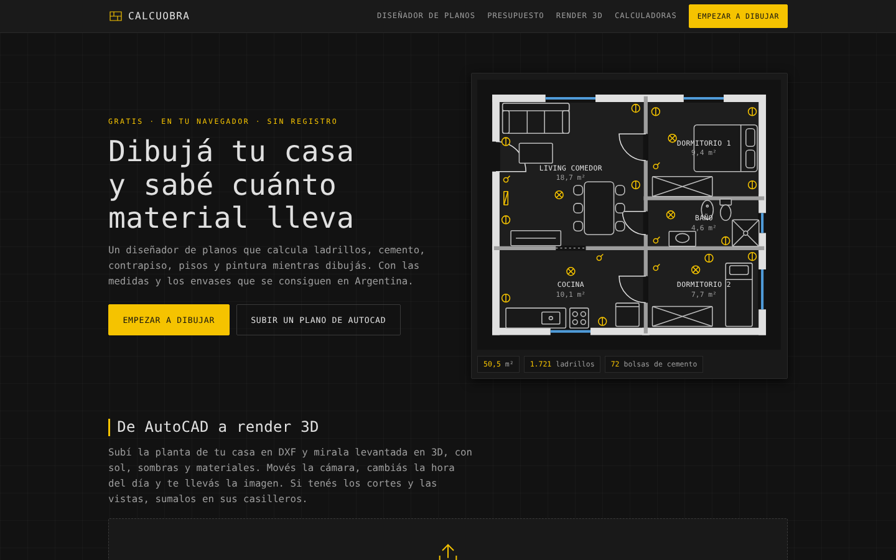
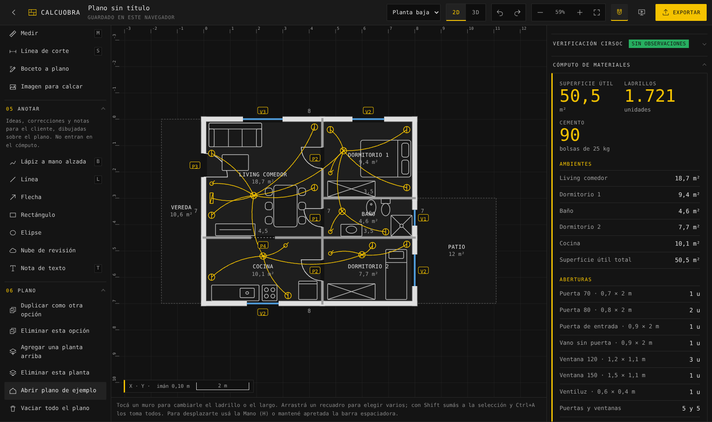
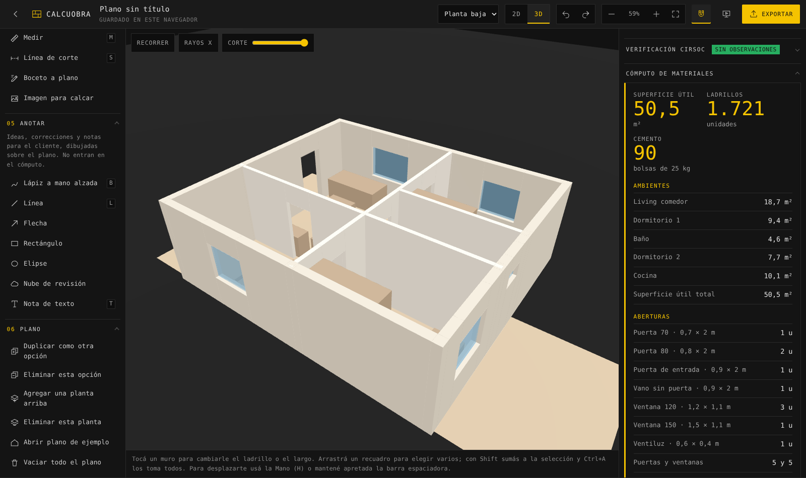
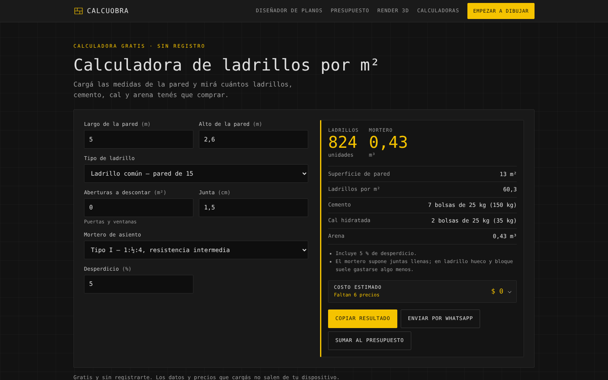
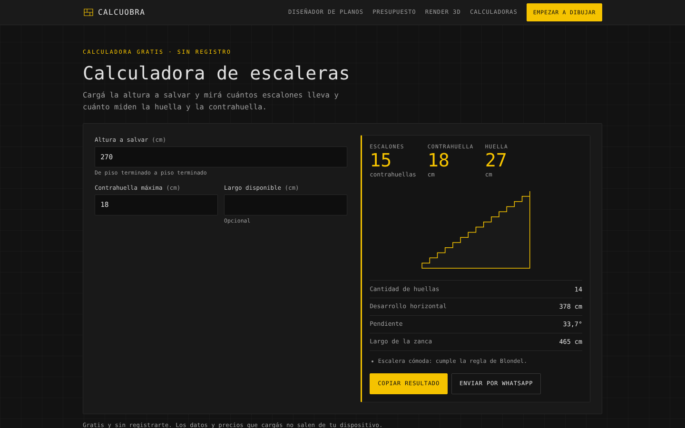
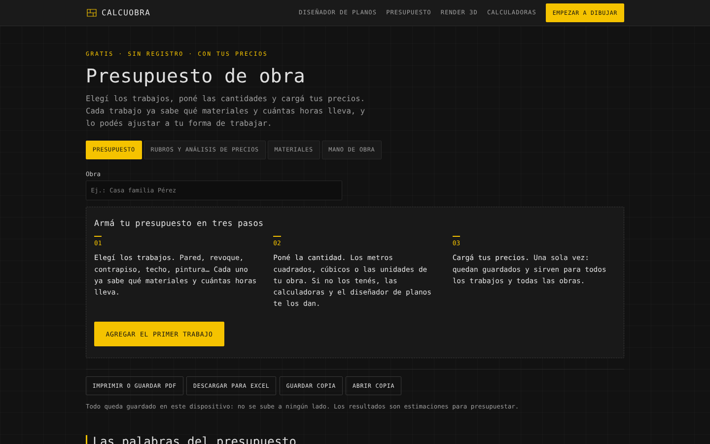

<div align="center">

# CalcuObra

### Draw your house and know how much material it takes

A free floor plan designer and construction calculators for Argentina.
**Runs entirely in the browser · no sign-up · no data leaves the device.**

</div>



---

## The idea

Anyone planning to build or extend a house in Argentina ends up asking the same questions: how many bricks, how many bags of cement, how much paint. The usual answer is a spreadsheet, a builder's estimate or a guess.

CalcuObra answers them while you draw. You sketch the plan, and the bill of materials updates with every wall, door and window — using the brick types, mortar mixes and package sizes you can actually buy in Argentina.

## Floor plan designer



- **Draw rooms, walls and openings** with snapping, from a library of real door and window sizes, across several floors.
- **Live bill of materials**: bricks, cement, lime, sand, subfloor, screed and paint, room by room.
- **Structural check against the Argentine CIRSOC codes** (CIRSOC 501-E for masonry up to three storeys and 101 for loads): load-bearing walls, minimum thickness, wall lengths in each direction, openings, and walls that must sit on the ones below. Each result cites the article it comes from. It supports the professional; it doesn't replace them.
- **Electrical layout**, furniture, and annotations for architects (redlining, revision clouds, notes), plus up to six design options side by side with a comparison table.
- **Sketch to plan**: a photo of a hand-drawn sketch becomes a clean plan, detecting walls, doors and windows.

## 3D view



The house rises in 3D with every floor, opening and piece of furniture. Walk through it at eye level, separate the floors, switch to X-ray, cut it at any height, and generate vertical sections. **Upload an AutoCAD DXF** and see it built in 3D, with sun, shadows and materials.

## From the plan to the paperwork

**Construction documents** come out of the same plan: scaled sheets with title block, dimensioned plans, roof plan, two sections, façades, electrical layout, site coverage ratios (FOS/FOT) and the lighting and ventilation schedule, from A3 to A0, ready to print or save as PDF.

Exports: PNG, SVG, DXF and PDF.

## Calculators and budget

| | |
|---|---|
|  |  |
| Bricks, mortar and cost per wall | Steps, riser and tread, checked with Blondel's rule |

Calculators for bricks, concrete, paint, ceramics, stairs and subfloors. Every result can be copied, sent by WhatsApp or **added to the budget**.



The **budget** follows the formal public works method: pick the jobs, enter quantities, and load your prices once. Each job already knows which materials and labour hours it takes, with unit price analysis by item. Exports to PDF and Excel.

## Technical notes

- **Static site, no backend, no build step for the app**: HTML, CSS and vanilla JavaScript. A small Node script generates one page per calculator from a single list, so adding a calculator is one function and one entry.
- **Three.js** for the 3D view and the DXF renderer.
- **Privacy by design**: plans, prices and budgets are stored only in the browser. Nothing is uploaded and no account is needed.
- Deployed on Vercel.

## Run it locally

```bash
node tools/serve.js    # http://localhost:8137
node tools/build.js    # regenerate the calculator pages
```

---

<div align="center">

**Matías Rosello** · [GitHub](https://github.com/rikochet87) · rosellomatias87@gmail.com

</div>
